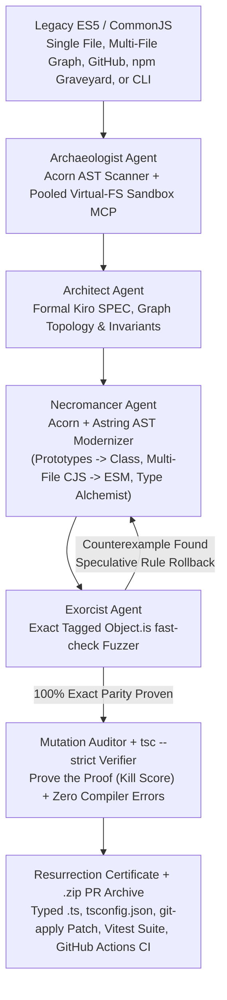

# Lazarus — Autonomous Legacy & Dead-Dependency Resurrection Engine

> **Kiroween 2026 (Frankenstein Category)** | **Live Studio:** [lazarus-yf0a.onrender.com](https://lazarus-yf0a.onrender.com) | **MIT License**
>
> **638 passing tests across 35 Vitest suites** · **16 `.kiro/specs/` suites** · **4-Agent Kiro Crew** · **Custom `lazarus-sandbox` MCP Server** · **`tsc --strict: 0 errors`**

Lazarus ingests unmaintained legacy ES5/CommonJS JavaScript—single files, **multi-file `require()` dependency graphs**, live **GitHub** URLs, packages from the **npm Graveyard**, or local directories via **CLI**—and autonomously resurrects them into strict ES2022/TypeScript backed by **exact `Object.is` differential fuzzing**, **live mutation testing**, and **real `tsc --strict` compiler verification**.

## System Architecture



## Quick Start

```bash
npm install
npm test                                                                   # 638 tests across 35 suites
npm start                                                                  # Launch Lazarus Studio on http://localhost:3000
npm run mcp                                                                # Start stdio MCP server (lazarus-sandbox)
npm run resurrect -- ./examples/legacy-quantize.cjs --out ./out            # Resurrect a single file via CLI
npm run resurrect -- ./examples/legacy-invoice-engine --out ./out-project  # Resurrect a multi-file CJS directory via CLI
```

## Real-World Legacy Parity Benchmark

| Specimen | Legacy Pattern | Subtle Edge Case Caught / Verified | Verified Outcome |
| :--- | :--- | :--- | :--- |
| `legacy-int-halve` | `var half = (n / 2) \| 0` | `Math.floor` diverges on negative odd integers (`-1` vs `-2`) | Self-healed + `tsc --strict: 0 errors` |
| `stringHash32` | ES5 hash loop with `\| 0` | 32-bit signed overflow (`-2147483648` vs `2147483648`) | Rule rolled back + 5/5 Mutants Killed |
| `legacyCounterClass` | `Counter.prototype.inc = function` | Prototype constructor, `this` binding, stateful methods | Lifted cleanly to ES2022 `class` |
| `cjsMathUtils` | Multi-export `exports.a / exports.b` | Multi-function CommonJS extraction + named ESM exports | 100% Exact Parity across all exports |
| `legacy-invoice-engine` | 3-file CommonJS `require('./...')` graph | Topological leaf-first stitching + whole-graph parity | Typed `.ts` project + `tsconfig.json` |
| `legacy-text-pipeline` | 3-file string pipeline (`trim`/`pad`/`slug`) | Relative CJS imports rewritten cleanly to ES2022 `import` | Typed `.ts` project + `tsc --strict` |
| `left-pad@1.3.0` (npm) | Live CDN fetch (`unpkg`/`jsdelivr`) | String coercion, padding boundaries, SHA-256 provenance | Verified + Resurrection Certificate |
| `fast-truncate-32` | `(a * 3) \| 0` | 32-bit signed truncation and `-0` vs `+0` (`Object.is`) | 100% Exact Parity |
| `es5-ascii-checksum` | `for (var i = 0; ...)` `charCodeAt` | Empty strings, Unicode boundaries, loop scoping | 100% Exact Parity |
| `mixAB` | Multi-parameter ES5 bitwise mix | Multi-parameter Acorn extraction + integer boundaries | 100% Exact Parity |

## Lazarus Studio V7 Highlights

- **3-Tab Lazarus Studio & Guided Judge Tour (`public/index.html`, `src/web/line-diff.ts`):** Organizes Single File & npm Graveyard, Multi-File Stitch Graph, and Sandbox Red-Team Lab into a clean studio workspace with a **1-click 20s Guided Judge Tour** and line-by-line red/green LCS diffing in the Self-Healing Matrix.
- **Multi-File CommonJS Graph Resurrection (`src/crew/graph-resurrector.ts`, `src/sandbox/virtual-fs.ts`):** Uses an isolated in-memory virtual `require()` loader (zero host filesystem access) to parse multi-file projects, resurrect dependencies in topological order, stream a live **SVG Dependency Graph**, and export typed `.ts` modules + `tsconfig.json` via UI or Directory CLI.
- **"Prove the Proof" Live Mutation Audit (`src/crew/mutation-audit.ts`, `POST /api/mutation-audit`):** Deliberately injects semantic AST bugs (boundary flips, `Math.trunc` → `Math.floor`, sign/guard sabotage) into resurrected code and runs Exorcist to prove real **Mutation Kill Strength** alongside `429 BUSY` anti-stacking protection.
- **Fuzz-Driven Type Alchemist & Real `tsc --strict` Verification (`src/crew/type-alchemist.ts`, `src/crew/ts-verifier.ts`):** Infers strict TypeScript annotations from observed fuzz traces and verifies generated single-file and multi-file `.ts` output directly with the TypeScript compiler (server-recomputed anti-tamper proofs stamped into the Resurrection Certificate and `SPEC.md`).
- **Exact Tagged `Object.is` Exorcist & Persistent Sandbox Pool (`src/fuzzer/differential.ts`, `src/sandbox/pool.ts`, `src/sandbox/redteam.ts`):** Enforces exact `Object.is` parity (`-0`, `NaN`, `±Infinity`, `undefined`) across both fuzzing and the live `POST /api/probe` playground, backed by pooled workers with **0 leaked Node processes** and a live **Red-Team Lab** (`Infinite Loop`, `process.exit(1)`, `256MB Heap Bomb`, `Hostile Escape`).
- **Live npm Graveyard, GitHub Importer & Zero-Dependency `.zip` PR Archive (`src/importer/npm.ts`, `src/exporter/zip.ts`, `src/exporter/certificate.ts`):** Allowlisted HTTPS fetching, deterministic SHA-256 Resurrection Certificates, `git apply`-verified patches, runnable `fast-check` Vitest suites, and `.github/workflows/lazarus-parity.yml`.
- **16 Kiro Specification Suites (`.kiro/specs/`):** `sandbox`, `mcp-server`, `differential-fuzzer`, `crew-orchestrator`, `web-ui`, `bundle-exporter`, `sandbox-pooling`, `ast-modernizer`, `judge-playground`, `exact-exorcist-and-prototypes`, `npm-graveyard-importer`, `grand-prize-polish`, `module-graph-necromancer`, `mutation-proof-and-types`, `strict-ts-verification`, and `studio-ux-and-diff` (**638 passing tests across 35 suites**).

