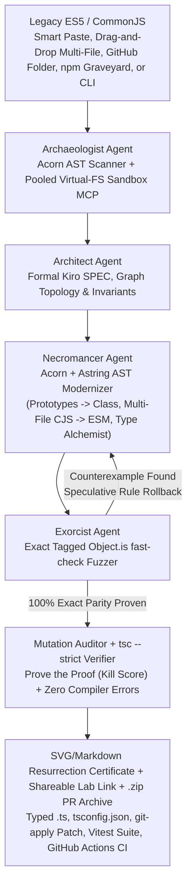

# Lazarus — Autonomous Legacy & Dead-Dependency Resurrection Engine

> **Kiroween 2026 (Frankenstein Category)** | **Live Studio:** [lazarus-yf0a.onrender.com](https://lazarus-yf0a.onrender.com) | **MIT License**
>
> **825 passing tests across 42 Vitest suites** · **19 `.kiro/specs/` suites** · **4 `.kiro/hooks/`** · **4-Agent Kiro Crew** · **Custom `lazarus-sandbox` MCP Server** · **`tsc --strict: 0 errors`**

Lazarus ingests unmaintained legacy ES5/CommonJS JavaScript—single files, **multi-file `require()` dependency graphs** (via drag-and-drop upload or live **GitHub Folder URL**), zero-config custom pastes, packages from the **npm Graveyard**, or local directories via **CLI**—and autonomously resurrects them into strict ES2022/TypeScript backed by **exact `Object.is` differential fuzzing**, **live mutation testing**, and **real `tsc --strict` compiler verification**.

## System Architecture



## Quick Start

```bash
npm install
npm test                                                                   # 825 tests across 42 suites
npm start                                                                  # Launch Lazarus Studio on http://localhost:3000
npm run mcp                                                                # Start stdio MCP server (lazarus-sandbox)
npm run benchmark                                                          # Run live parity & tsc --strict benchmark across all presets
npm run resurrect -- ./examples/legacy-quantize.cjs --out ./out            # Resurrect a single file via CLI
npm run resurrect -- ./examples/legacy-invoice-engine --out ./out-project  # Resurrect a multi-file CJS directory via CLI
```

## Real-World Legacy Parity Benchmark

| Specimen | Legacy Pattern | Subtle Edge Case Caught / Verified | Verified Outcome |
| :--- | :--- | :--- | :--- |
| `legacy-int-halve` | `var half = (n / 2) \| 0` | `Math.floor` diverges on negative odd integers (`-1` vs `-2`) | Self-healed + `tsc --strict: 0 errors` |
| `stringHash32` | ES5 hash loop with `\| 0` | 32-bit signed overflow (`-2147483648` vs `2147483648`) | Rule rolled back + 5/5 Mutants Killed |
| `legacyCounterClass` | `Counter.prototype.inc = function` | Prototype constructor, `this` binding, stateful methods | Lifted cleanly to ES2022 `class` |
| `cjsMathUtils` | Multi-export `exports.a / exports.b` | Multi-function CommonJS extraction + named ESM exports | 100% Exact Parity across all exports |
| `legacy-invoice-engine` | 3-file CommonJS `require('./...')` graph | Topological leaf-first stitching + whole-graph parity | Typed `.ts` project + `tsconfig.json` |
| `legacy-text-pipeline` | 3-file string pipeline (`trim`/`pad`/`slug`) | Relative CJS imports rewritten cleanly to ES2022 `import` | Typed `.ts` project + `tsc --strict` |
| `left-pad@1.3.0` (npm) | Live CDN fetch (`unpkg`/`jsdelivr`) | String coercion, padding boundaries, SHA-256 provenance | Verified + SVG/MD Certificate |
| `fast-truncate-32` | `(a * 3) \| 0` | 32-bit signed truncation and `-0` vs `+0` (`Object.is`) | 100% Exact Parity |
| `es5-ascii-checksum` | `for (var i = 0; ...)` `charCodeAt` | Empty strings, Unicode boundaries, loop scoping | 100% Exact Parity |
| `mixAB` | Multi-parameter ES5 bitwise mix | Multi-parameter Acorn extraction + integer boundaries | 100% Exact Parity |

## Lazarus Studio V10 Highlights

- **Real-World Multi-File Intake (`src/importer/github-dir.ts`, `POST /api/import/github-dir`):** Drag-and-drop multiple local `.js`/`.cjs` files or paste any live **GitHub Folder URL** (`github.com/owner/repo/tree/branch/path`, allowlisted HTTPS, 8-file / 128 KB cap) directly into Tab 2 with automatic entry-module inference.
- **Live Kiro DNA Drawer & 4 Agent Hooks (`GET /api/kiro-dna`, `.kiro/hooks/`):** Reads `.kiro/specs/` (19 specs), `.kiro/agents/` (4 Crew personas), `.kiro/hooks/` (`run-tests-on-save`, `sandbox-security-guard`, `strict-typecheck-on-crew`, `kiro-dna-sync-check`), and `.kiro/steering/` live from disk alongside an interactive **4-Organ Chimera Diagram**.
- **Zero-Config Smart Paste & Shareable Lab Links (`src/web/smart-paste.ts`, `public/index.html`):** Auto-detects `string`, `number`, and `boolean` schemas on custom pasted JS, guards against stale PR exports when source edits occur, and generates one-click `#specimen=` shareable lab permalinks.
- **3-Tab Studio, Widescreen Verification Deck & Guided Judge Tour (`public/index.html`, `src/web/line-diff.ts`):** Full-width Self-Healing Matrix, red/green LCS diffing, `AbortController`-guarded 20s Guided Judge Tour (auto-dismissing on tab switch), muted-by-default Web Audio chimes, and live **MCP Wire-Trace Inspector**.
- **Multi-File Graph Resurrection, Live Mutation Audit & `tsc --strict` (`src/crew/`):** In-memory virtual `require()` sandbox, live SVG Dependency Graph, semantic AST mutation testing (**Mutation Kill Strength**), and server-recomputed `tsc --strict: 0 errors` compiler proofs.
- **SVG/Markdown Certificates, GitHub PR Summary & `.zip` Archive (`src/exporter/`):** Deterministic SHA-256 certificates (`.svg` + Markdown), one-click GitHub PR descriptions, zero-dependency `.zip` PR bundles with `.github/workflows/lazarus-parity.yml`, and `npm run benchmark`.
- **19 Kiro Specification Suites (`.kiro/specs/`):** `sandbox`, `mcp-server`, `differential-fuzzer`, `crew-orchestrator`, `web-ui`, `bundle-exporter`, `sandbox-pooling`, `ast-modernizer`, `judge-playground`, `exact-exorcist-and-prototypes`, `npm-graveyard-importer`, `grand-prize-polish`, `module-graph-necromancer`, `mutation-proof-and-types`, `strict-ts-verification`, `studio-ux-and-diff`, `flagship-studio-polish`, `kiro-dna-and-smart-paste`, and `repo-intake-and-hooks` (**825 passing tests across 42 suites**).

