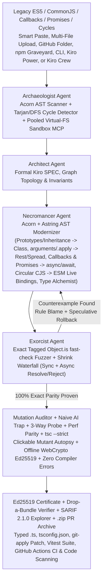

# Lazarus — Autonomous Legacy & Dead-Dependency Resurrection Engine

> **Kiroween Hackathon 2026 (Frankenstein Category)** | **Live Studio:** [lazarus-yf0a.onrender.com](https://lazarus-yf0a.onrender.com) | **Companion Kiro Crew App:** [lazarus-kiro-crew](https://github.com/anjarkar25-max/lazarus-kiro-crew) | **MIT License**
>
> **1,209 verified tests** (`1,318` combined with `lazarus-kiro-crew`'s 109 tests) · **119 headless E2E browser checks (`0` errors)** · **27 `.kiro/specs/` suites** · **Installable Kiro Power (`power-lazarus/`)** · **4 `.kiro/hooks/`** · **4-Agent Kiro Crew** · **Custom `lazarus-sandbox` MCP Server** · **Offline WebCrypto Ed25519 Proofs** · **SARIF 2.1.0** · **`tsc --strict: 0 errors`**

Lazarus ingests unmaintained legacy ES5/CommonJS JavaScript—single files, **ES5 prototype inheritance / `arguments` / `.apply()`**, **Node.js error-first `(err, res)` callbacks**, **Promise `.then().catch()` chains**, **multi-file & circular `require()` dependency graphs** (drag-and-drop upload or live **GitHub Folder URL**), zero-config pastes, packages from the **npm Graveyard**, or local directories via **CLI**—and autonomously resurrects them into strict ES2022/TypeScript backed by **4-pillar proof**: **exact `Object.is` differential fuzzing with live shrink traces**, **clickable AST Mutant Autopsies & Rule Blame X-Ray**, **zero-trust browser WebCrypto Ed25519 verification with 1-byte tamper detection**, and **runtime Performance Parity micro-benchmarks**.

## System Architecture



## Quick Start

```bash
npm install
npm test                                                                   # 1,209 verified unit & integration tests
npm run test:e2e                                                           # 119 live headless browser E2E checks (0 errors)
npm start                                                                  # Launch Lazarus Studio on http://localhost:3000
npm run mcp                                                                # Start stdio MCP server (lazarus-sandbox)
npm run audit -- ./examples/legacy-circular-ledger                         # Scan a legacy repo for bitwise, callback, prototype & cycle risks
npm run audit -- ./examples/legacy-circular-ledger --sarif --out out.sarif # Export GitHub Code Scanning SARIF 2.1.0 report
npm run verify -- ./out/resurrection-bundle.zip                            # Verify an Ed25519 signed Resurrection Certificate bundle
npm run benchmark                                                          # Run live parity & tsc --strict benchmark across all presets
npm run resurrect -- ./examples/legacy-quantize.cjs --out ./out            # Resurrect a single file via CLI
npm run resurrect -- ./examples/legacy-circular-ledger --out ./out-project # Resurrect a circular multi-file CJS graph via CLI
```

## Install Across the Kiro Ecosystem

- **Kiro Power (`power-lazarus/`):** In **Kiro IDE** → **Powers** → **Add Custom Power** → import `power-lazarus/` (or GitHub URL `https://github.com/anjarkar25-max/lazarus/tree/main/power-lazarus`). Mentioning `legacy`, `commonjs`, `es5`, `resurrect`, or `mutation-audit` loads Lazarus's skills (`--sarif` audits + resurrection) and `lazarus-sandbox` MCP server on demand.
- **Companion Kiro Crew App (`anjarkar25-max/lazarus-kiro-crew`):** Install via `kirocrew app install https://github.com/anjarkar25-max/lazarus-kiro-crew.git --ref main` for 3 autonomous Crew agents, 2 skills, a weekday legacy audit cron, `Cmd+K` commands, and an `@kirocrew/app-sdk` Mission Control dashboard with a 3-agent handoff timeline, live Naive AI trap, Perf Parity, Ed25519 1-byte tamper check, and inline SARIF 2.1.0 audit (**109 passing tests** + local `npm run preview` harness).

## Real-World Legacy Parity Benchmark

| Specimen | Legacy Pattern | Subtle Edge Case Caught / Verified | Verified Outcome |
| :--- | :--- | :--- | :--- |
| `legacy-int-halve` | `var half = (n / 2) \| 0` | Naive refactor fails on `-0` (`Object.is(-0, +0)`) & negative odds (`-3`) | Self-healed + Perf Parity + `tsc --strict` |
| `stringHash32` | ES5 hash loop with `\| 0` | 32-bit signed overflow (`338917376` vs Naive `7.22e+59`) | Shrink Trace + Rule Blame + Mutant Autopsy |
| `legacySubclassMeter` | `Object.create` inheritance + `arguments`/`.apply()` | Prototype chain, `super()`, rest/spread lifting | ES2022 `class extends` + `tsc --strict` |
| `legacyReadConfigCb` | Node `(input, cb)` error-first callback | Both resolve values (`Object.is`) and error-path rejections | Lifted to `async/await` + `tsc --strict` |
| `legacyPromiseChain` | Legacy `.then().catch()` chain | Resolved values & error recovery parity | Lifted to `async/await` + `try/catch` |
| `legacyCounterClass` | `Counter.prototype.inc = function` | Prototype constructor, `this` binding, stateful methods | Lifted cleanly to ES2022 `class` |
| `cjsMathUtils` | Multi-export `exports.a / exports.b` | Multi-function CommonJS extraction + named ESM exports | 100% Exact Parity across all exports |
| `legacy-circular-ledger` | 3-file circular `require()` cycle (`tax.cjs ↔ discount.cjs`) | Mutual CommonJS cycles lifted to cycle-safe ES2022 live bindings | Amber cycle graph + `tsc --strict` |
| `legacy-invoice-engine` | 3-file CommonJS `require('./...')` graph | Topological leaf-first stitching + whole-graph parity | Typed `.ts` project + SARIF CI |
| `left-pad@1.3.0` (npm) | Live CDN fetch (`unpkg`/`jsdelivr`) | String coercion, padding boundaries, Ed25519 + SHA-256 provenance | Verified + Signed Certificate |

## Lazarus Studio V17 Highlights

- **Hardcore ES5 & Async Lifters (`src/crew/es5-idioms.ts`, `src/crew/async-callback.ts`):** Deterministically modernises `Object.create` prototype inheritance, scope-safe constructors, `arguments`/`.apply()`, error-first `(err, res)` callbacks, and `.then().catch()` Promise chains across Web Studio, CLI, and MCP.
- **Live `fast-check` Shrink Trace & Clickable Rule Blame X-Ray (`public/index.html`):** Expand the exact counterexample shrinking waterfall inside the Causal Rollback Strip and click any AST rule chip to highlight affected or rolled-back diff lines.
- **Zero-Trust Offline WebCrypto Ed25519 & Drop-a-Bundle Verifier (`src/exporter/cert-crypto.ts`, `POST /api/verify-bundle`):** Verifies Ed25519 Resurrection Certificates directly inside the browser via `crypto.subtle`, includes a live `Simulate 1-Byte Tamper` button, and lets judges drop any exported `.zip` PR archive into the `Verify Bundle` drawer.
- **Interactive SARIF 2.1.0 Risk Explorer & Circular CJS Cycle Resolver (`POST /api/audit-sarif`, `examples/legacy-circular-ledger/`):** Inspect clickable `LAZ001`–`LAZ007` findings and download `.sarif` directly from Studio, resolve mutual CommonJS `require()` cycles with amber SVG cycle edges, and ship drop-in `.github/workflows/lazarus-audit.yml` CI.
- **Runtime Performance Parity, Mutant Autopsy & 3-Way Judge Probe (`src/crew/perf-parity.ts`, `src/crew/mutation-audit.ts`, `src/crew/naive-refactor.ts`):** Compare Legacy, Naive AI, and Lazarus side-by-side on custom adversarial inputs, inspect exact AST mutant killer counterexamples, and verify micro-benchmark throughput parity.
- **Installable Kiro Power (`power-lazarus/`), Live Kiro DNA Drawer, 4 v1 Hooks & 119-Check E2E Audit (`GET /api/kiro-dna`, `scripts/e2e-smoke.mjs`):** Reads all **27 `.kiro/specs/`**, 4 Crew personas, 4 hooks, steering docs, and `power-lazarus/` live from disk, backed by zero-error headless browser E2E verification and accessible single-active-drawer keyboard UX.

