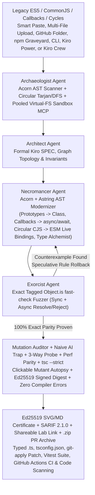

# Lazarus — Autonomous Legacy & Dead-Dependency Resurrection Engine

> **Kiroween Hackathon 2026 (Frankenstein Category)** | **Live Studio:** [lazarus-yf0a.onrender.com](https://lazarus-yf0a.onrender.com) | **Companion Kiro Crew App:** [lazarus-kiro-crew](https://github.com/anjarkar25-max/lazarus-kiro-crew) | **MIT License**
>
> **1,066 passing tests** (`1,145` combined with `lazarus-kiro-crew`'s 79 tests) · **24 `.kiro/specs/` suites** · **Installable Kiro Power (`power-lazarus/`)** · **4 `.kiro/hooks/`** · **4-Agent Kiro Crew** · **Custom `lazarus-sandbox` MCP Server** · **Ed25519 Signed Proofs** · **SARIF 2.1.0** · **`tsc --strict: 0 errors`**

Lazarus ingests unmaintained legacy ES5/CommonJS JavaScript—single files, **Node.js error-first `(err, res)` callbacks**, **multi-file & circular `require()` dependency graphs** (via drag-and-drop upload or live **GitHub Folder URL**), zero-config custom pastes, packages from the **npm Graveyard**, or local directories via **CLI**—and autonomously resurrects them into strict ES2022/TypeScript backed by **4-pillar mathematical proof**: **exact `Object.is` differential fuzzing**, **clickable AST Mutant Autopsies**, **Ed25519 cryptographic signatures with live 1-byte tamper detection**, and **runtime Performance Parity micro-benchmarks**.

## System Architecture



## Quick Start

```bash
npm install
npm test                                                                   # 1,066 passing tests
npm start                                                                  # Launch Lazarus Studio on http://localhost:3000
npm run mcp                                                                # Start stdio MCP server (lazarus-sandbox)
npm run audit -- ./examples/legacy-circular-ledger                         # Scan a legacy repo for bitwise, callback, prototype & cycle risks
npm run audit -- ./examples/legacy-circular-ledger --sarif --out out.sarif # Export GitHub Code Scanning SARIF 2.1.0 report
npm run verify -- ./out/resurrection-bundle.zip                            # Verify an Ed25519 signed Resurrection Certificate bundle
npm run benchmark                                                          # Run live parity & tsc --strict benchmark across all presets
npm run resurrect -- ./examples/legacy-quantize.cjs --out ./out            # Resurrect a single file via CLI
npm run resurrect -- ./examples/legacy-circular-ledger --out ./out-project # Resurrect a circular multi-file CJS graph via CLI
```

## Install Across the Kiro Ecosystem

- **Kiro Power (`power-lazarus/`):** In **Kiro IDE** → **Powers** → **Add Custom Power** → import `power-lazarus/` (or GitHub URL `https://github.com/anjarkar25-max/lazarus/tree/main/power-lazarus`). Mentioning `legacy`, `commonjs`, `es5`, `resurrect`, or `mutation-audit` loads Lazarus's skills (`--sarif` audits + resurrection) and `lazarus-sandbox` MCP server on demand.
- **Companion Kiro Crew App (`anjarkar25-max/lazarus-kiro-crew`):** Install via `kirocrew app install https://github.com/anjarkar25-max/lazarus-kiro-crew.git --ref main` for 3 autonomous Crew agents, 2 skills, a scheduled weekday legacy audit cron, `Cmd+K` commands, and an `@kirocrew/app-sdk` dashboard with live Naive AI trap & Ed25519 tamper checks (**79 passing tests** + local `npm run preview` harness).

## Real-World Legacy Parity Benchmark

| Specimen | Legacy Pattern | Subtle Edge Case Caught / Verified | Verified Outcome |
| :--- | :--- | :--- | :--- |
| `legacy-int-halve` | `var half = (n / 2) \| 0` | Naive refactor fails on `-0` (`Object.is(-0, +0)`) & negative odds (`-3`) | Self-healed + Perf Parity + `tsc --strict` |
| `stringHash32` | ES5 hash loop with `\| 0` | 32-bit signed overflow (`338917376` vs Naive `7.22e+59`) | Rule rolled back + Mutant Autopsy |
| `legacyReadConfigCb` | Node `(input, cb)` error-first callback | Both resolve values (`Object.is`) and error-path rejections | Lifted to `async/await` + `tsc --strict` |
| `legacyCounterClass` | `Counter.prototype.inc = function` | Prototype constructor, `this` binding, stateful methods | Lifted cleanly to ES2022 `class` |
| `cjsMathUtils` | Multi-export `exports.a / exports.b` | Multi-function CommonJS extraction + named ESM exports | 100% Exact Parity across all exports |
| `legacy-circular-ledger` | 3-file circular `require()` cycle (`tax.cjs ↔ discount.cjs`) | Mutual CommonJS cycles lifted to cycle-safe ES2022 live bindings | Amber cycle graph + `tsc --strict` |
| `legacy-invoice-engine` | 3-file CommonJS `require('./...')` graph | Topological leaf-first stitching + whole-graph parity | Typed `.ts` project + SARIF CI |
| `legacy-text-pipeline` | 3-file string pipeline (`trim`/`pad`/`slug`) | Relative CJS imports rewritten cleanly to ES2022 `import` | Typed `.ts` project + `tsc --strict` |
| `left-pad@1.3.0` (npm) | Live CDN fetch (`unpkg`/`jsdelivr`) | String coercion, padding boundaries, Ed25519 + SHA-256 provenance | Verified + Signed Certificate |

## Lazarus Studio V14 Highlights

- **Circular CommonJS Cycle Resolver (`examples/legacy-circular-ledger/`, Tab 2):** Detects mutually recursive `require()` cycles via Tarjan/DFS, highlights cycle edges in amber on the live SVG graph, and emits cycle-safe ES2022 live bindings verified with `tsc --strict`.
- **GitHub Code Scanning SARIF 2.1.0 (`npm run audit -- <dir> --sarif`):** Emits valid SARIF 2.1.0 JSON (`LAZ001`–`LAZ005`) and bundles `.github/workflows/lazarus-audit.yml` inside exported `.zip` PR archives for drop-in GitHub Advanced Security integration.
- **Runtime Performance Parity Proof (`src/crew/perf-parity.ts`, `POST /api/perf-parity`):** Runs bounded micro-benchmarks inside the isolated sandbox comparing Legacy ES5 vs. Resurrected ES2022 throughput right beside correctness, mutation, and Ed25519 badges.
- **Ed25519 Signed Certificates & Live 1-Byte Tamper Verifier (`src/exporter/cert-crypto.ts`, `POST /api/verify-certificate`, `npm run verify`):** Cryptographically signs every resurrection digest with `node:crypto` Ed25519 and detects single-byte tampering live in the browser and CLI.
- **3-Way Interactive Judge Probe, Causal Rollback Strip & Auto-Docking Tour (`public/index.html`):** Run Legacy, Naive AI, and Lazarus Proven side-by-side on custom adversarial inputs (`-0`, `-3`, `2147483648`, `NaN`) with a visual 4-node rollback strip.
- **Interactive Mutant Autopsy, Naive AI Trap & Error-First Callback → `async/await` Necromancer:** Click `Mutants Killed` to inspect exact injected AST faults and shrunken killer inputs, expose live Naive AI failures with zero external API keys, and lift Node `(err, res)` callbacks to typed `async/await`.
- **Installable Kiro Power (`power-lazarus/`), Live Kiro DNA Drawer & 4 v1 Hooks (`GET /api/kiro-dna`):** Reads all **24 `.kiro/specs/`**, 4 Crew personas, 4 hooks, steering docs, and `power-lazarus/` live from disk.

