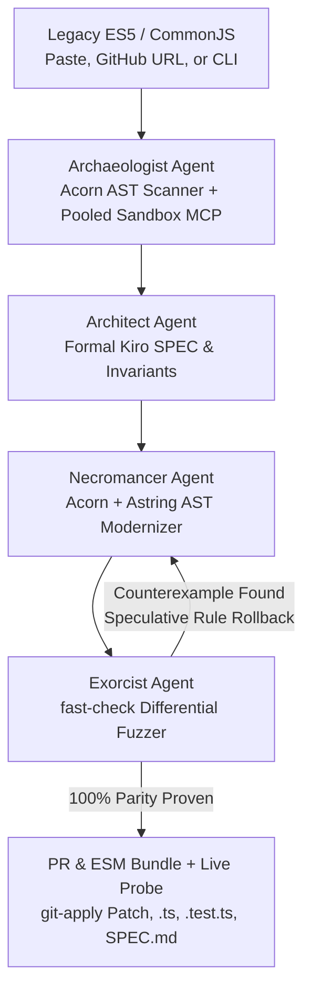

# Lazarus — Autonomous Legacy & Dead-Dependency Resurrection Engine

> **Kiroween 2026 (Frankenstein Category)** | **Live Operating Table:** [lazarus-yf0a.onrender.com](https://lazarus-yf0a.onrender.com) | **MIT License**
>
> **284 passing tests across 17 Vitest suites** · **9 `.kiro/specs/` suites** · **4-Agent Kiro Crew** · **Custom `lazarus-sandbox` MCP Server**

Lazarus ingests unmaintained legacy ES5/CommonJS JavaScript (pasted directly, imported from GitHub, or passed via CLI) and autonomously resurrects it into modern ES2022/TypeScript with **mathematical proof of 100% behavioral parity** via `fast-check` differential property-based fuzzing.

## System Architecture



## Quick Start

```bash
npm install
npm test                                                           # 284 tests across 17 suites
npm start                                                          # Launch Operating Table on http://localhost:3000
npm run mcp                                                        # Start stdio MCP server (lazarus-sandbox)
npm run resurrect -- ./examples/legacy-quantize.cjs --out ./out    # Resurrect a local file via CLI
```

## Real-World Legacy Parity Benchmark

| Specimen | Legacy Pattern | Subtle Edge Case Caught / Verified | Verified Outcome |
| :--- | :--- | :--- | :--- |
| `legacy-int-halve` | `var half = (n / 2) \| 0` | `Math.floor` diverges on negative odd integers (`-1` vs `-2`) | Self-healed to `Math.trunc` |
| `stringHash32` | ES5 hash loop with `\| 0` | 32-bit signed overflow (`-2147483648` vs `2147483648`) | Speculative rule rolled back automatically |
| `fast-truncate-32` | `(a * 3) \| 0` | 32-bit signed truncation and `-0` vs `+0` (`Object.is`) | 100% Parity |
| `es5-ascii-checksum` | `for (var i = 0; ...)` `charCodeAt` | Empty strings, Unicode boundaries, loop scoping | 100% Parity |
| `truncateHalf` (`.cjs`) | `module.exports = function` | Multi-line CommonJS AST unwrapping + `\| 0` semantics | 100% Parity |
| `legacyLeftPad` | ES5 `while` string padding | Coercion + variable string lengths (`fc.string`) | 100% Parity |
| `mixAB` | Multi-parameter ES5 bitwise mix | Multi-parameter Acorn extraction + integer boundaries | 100% Parity |
| `quantizeClamp` (`.cjs`) | CommonJS clamp + `(x / 3) \| 0` | Boundary clamping `[-100, 100]` + negative truncation | 100% Parity |

## V4 Architecture Upgrades

- **Persistent Sandbox Pooling (`src/sandbox/pool.ts`, `src/sandbox/vm-executor.ts`):** Reuses isolated worker processes with fresh VM contexts per probe, automatic respawn on `TIMEOUT`/OOM/worker crash, **0 leaked Node processes**, and **sub-second live 100-run fuzzing** (~10x suite speedup).
- **Real AST-to-AST ES5 → ES2022 Engine (`src/crew/ast-modernizer.ts`, `src/crew/ast-scope.ts`, `src/crew/esm-export.ts`):** Uses `acorn` + `astring` to modernize `var` scoping, callbacks, `arguments`/`.apply`, `| 0` truncation, and CommonJS exports—with **counterexample-guided speculative rollback** whenever Exorcist catches a divergence.
- **Judge Playground & Live Edge-Case Probe (`POST /api/probe`, `src/sandbox/tagged.ts`, `src/sandbox/ast-scanner.ts`):** Multi-parameter Acorn extraction, visual **Self-Healing Attempt Matrix** (Rejected Draft vs. Verified Code), and an interactive **Probe Custom Edge Case** card using tagged JSON serialization to preserve exact `Object.is` `-0` and `NaN` parity over HTTP.
- **GitHub Importer, Tabbed PR/ESM Exporter & Local CLI (`src/importer/github.ts`, `src/exporter/bundle.ts`, `src/cli.ts`):** Strict HTTPS domain-allowlisted GitHub `.js`/`.cjs` import, `git apply`-compatible PR patches, runnable `fast-check` Vitest suites, and a sandbox-hardened CLI that refuses to write output if parity cannot be proven.
- **9 Kiro Specification Suites (`.kiro/specs/`):** `sandbox`, `mcp-server`, `differential-fuzzer`, `crew-orchestrator`, `web-ui`, `bundle-exporter`, `sandbox-pooling`, `ast-modernizer`, and `judge-playground` (**284 passing tests across 17 suites**).

