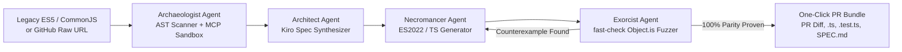

# LAZARUS — Autonomous Legacy & Dead-Dependency Resurrection Engine

> **Kiroween 2026 Submission — Frankenstein Category**  
> Stitching isolated legacy execution sandboxes together with a 4-agent Kiro Crew, custom MCP tooling, and `fast-check` differential property-based fuzzing.

## What Lazarus Does
Engineering teams sit on unmaintained, untested legacy modules they are afraid to touch. **Lazarus** resurrects abandoned JavaScript/CommonJS logic into modern ES2022+ code with mathematical proof of behavioral parity:

1. **Archaeologist Agent (`.kiro/agents/archaeologist.json`):** Executes the legacy module inside an isolated child-process sandbox (`src/sandbox/`) with strict memory, timeout, filesystem, and network restrictions to capture baseline I/O traces.
2. **Architect Agent (`.kiro/agents/architect.json`):** Synthesizes observed runtime behavior into formal Kiro specifications (`requirements.md` + behavioral invariants).
3. **Necromancer Agent (`.kiro/agents/necromancer.json`):** Rewrites the legacy code into clean ES2022+ while preserving subtle JavaScript edge cases.
4. **Exorcist Agent (`.kiro/agents/exorcist.json`):** Runs **differential property-based fuzzing** (`src/fuzzer/`) using `fast-check` across both the legacy sandbox and the modernized build (`Object.is` parity checks for `-0` vs `+0`, `NaN`, and integer truncation). If a mismatch occurs, Exorcist shrinks it to a minimal counterexample and feeds it back to Necromancer to self-heal automatically.

## Architecture & `.kiro/` Artifacts
- **Steering Docs (`.kiro/steering/`):** `architecture.md`, `sandbox-security.md`, and `ui-aesthetics.md`.
- **Spec-Driven Development (`.kiro/specs/`):** Full `requirements.md`, `design.md`, and `tasks.md` specs for `sandbox`, `mcp-server`, `differential-fuzzer`, `crew-orchestrator`, and `web-ui`.
- **Custom MCP Server (`.kiro/settings/mcp.json` & `src/mcp/server.ts`):** Exposes `run_legacy_probe` over stdio so Kiro agents can safely execute legacy snippets.
- **Agent Hooks (`.kiro/hooks/run-tests-on-save.json`):** Automatically runs `npx vitest run` whenever TypeScript files in `src/` are modified.
- **Custom Kiro Crew Agents (`.kiro/agents/`):** Specialized definitions for `archaeologist`, `architect`, `necromancer`, and `exorcist`.

## Quick Start

```bash
npm install
npm test        # Runs all 102 unit, integration, and property-based tests
npm start       # Launches the Resurrection Operating Table at http://localhost:3000
Open **`http://localhost:3000`**, select **Preset 1 (Self-Healing Demo)**, and click **RESURRECT SPECIMEN** to watch Exorcist catch a naive `Math.floor` negative-integer bug via fuzzing and auto-heal it to `Math.trunc`.

## System Architecture



## Real-World Legacy Parity Benchmark

| Specimen | Legacy Pattern | Subtle Edge Case Caught / Verified | Verified Outcome |
| :--- | :--- | :--- | :--- |
| `legacy-int-halve` | `var half = (n / 2) \| 0` | `Math.floor` diverges on negative odd integers (`-1` vs `-2`) | Self-healed to `Math.trunc` |
| `fast-truncate-32` | `(a * 3) \| 0` | 32-bit signed truncation and `-0` vs `+0` (`Object.is`) | 100% Parity |
| `es5-ascii-checksum` | `for (var i = 0; ...)` `charCodeAt` | Empty strings, Unicode boundaries, loop scoping | 100% Parity |
| `truncateHalf` (`.cjs`) | `module.exports = function` | Multi-line CommonJS AST unwrapping + `\| 0` semantics | 100% Parity |
| `legacyLeftPad` | ES5 `while` string padding | Coercion + variable string lengths (`fc.string`) | 100% Parity |
| `quantizeClamp` (`.cjs`) | CommonJS clamp + `(x / 3) \| 0` | Boundary clamping `[-100, 100]` + negative truncation | 100% Parity |

## V2 / V3 Architecture Upgrades
- **Live GitHub & CommonJS AST Importer (`src/importer/github.ts`, `src/sandbox/ast-scanner.ts`):** Ingests raw `.js`/`.cjs` files from GitHub with strict HTTPS domain allowlisting, 5-second abort timeout, 32 KB size cap, honest UI error banners, and multi-function `module.exports` AST idiom extraction.
- **Tabbed PR & Vitest Bundle Exporter (`src/exporter/bundle.ts`):** Generates a schema-aware TypeScript module (`resurrected.ts`), unified GitHub Pull Request diff (`.patch`), formal Kiro `SPEC.md`, and runnable `fast-check` Vitest suite (`resurrected.test.ts`) with one-click Copy and direct file downloads.
- **6th Kiro Specification Suite (`.kiro/specs/bundle-exporter/`):** Full requirements, architecture design, task breakdown, and 22 unit + property tests (**108 passing tests across 11 suites**).

