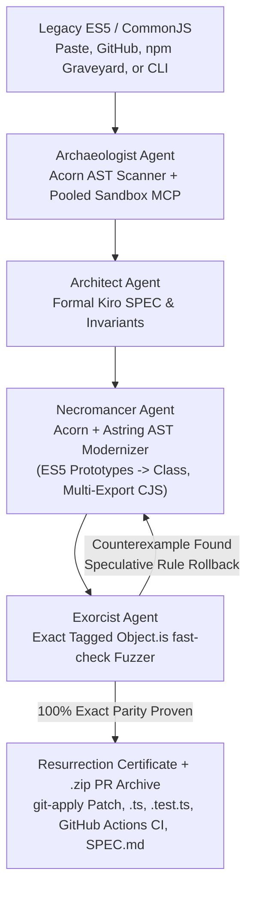

# Lazarus — Autonomous Legacy & Dead-Dependency Resurrection Engine

> **Kiroween 2026 (Frankenstein Category)** | **Live Operating Table:** [lazarus-yf0a.onrender.com](https://lazarus-yf0a.onrender.com) | **MIT License**
>
> **479 passing tests across 27 Vitest suites** · **12 `.kiro/specs/` suites** · **4-Agent Kiro Crew** · **Custom `lazarus-sandbox` MCP Server**

Lazarus ingests unmaintained legacy ES5/CommonJS JavaScript—pasted directly, fetched from **GitHub**, imported live from the **npm Graveyard**, or passed via **CLI**—and autonomously resurrects it into modern ES2022/TypeScript with **mathematical proof of exact `Object.is` behavioral parity** via `fast-check` differential property-based fuzzing.

## System Architecture



## Quick Start

```bash
npm install
npm test                                                           # 479 tests across 27 suites
npm start                                                          # Launch Operating Table on http://localhost:3000
npm run mcp                                                        # Start stdio MCP server (lazarus-sandbox)
npm run resurrect -- ./examples/legacy-quantize.cjs --out ./out    # Resurrect a local file via CLI
```

## Real-World Legacy Parity Benchmark

| Specimen | Legacy Pattern | Subtle Edge Case Caught / Verified | Verified Outcome |
| :--- | :--- | :--- | :--- |
| `legacy-int-halve` | `var half = (n / 2) \| 0` | `Math.floor` diverges on negative odd integers (`-1` vs `-2`) | Self-healed to `Math.trunc` |
| `stringHash32` | ES5 hash loop with `\| 0` | 32-bit signed overflow (`-2147483648` vs `2147483648`) | Speculative rule rolled back automatically |
| `legacyCounterClass` | `Counter.prototype.inc = function` | Prototype constructor, `this` binding, and stateful methods | Lifted cleanly to ES2022 `class` |
| `cjsMathUtils` | Multi-export `exports.a / exports.b` | Multi-function CommonJS extraction + named ESM exports | 100% Parity across all exports |
| `left-pad@1.3.0` (npm) | Live CDN fetch (`unpkg`/`jsdelivr`) | String coercion, padding boundaries, SHA-256 provenance | Verified + Resurrection Certificate |
| `fast-truncate-32` | `(a * 3) \| 0` | 32-bit signed truncation and `-0` vs `+0` (`Object.is`) | 100% Exact Parity |
| `es5-ascii-checksum` | `for (var i = 0; ...)` `charCodeAt` | Empty strings, Unicode boundaries, loop scoping | 100% Exact Parity |
| `mixAB` | Multi-parameter ES5 bitwise mix | Multi-parameter Acorn extraction + integer boundaries | 100% Exact Parity |
| `truncateHalf` (`.cjs`) | `module.exports = function` | Multi-line CommonJS AST unwrapping + `\| 0` semantics | 100% Exact Parity |
| `quantizeClamp` (`.cjs`) | CommonJS clamp + `(x / 3) \| 0` | Boundary clamping `[-100, 100]` + negative truncation | 100% Exact Parity |

## V5 Grand-Prize Architecture

- **Persistent Sandbox Pooling & Live Red-Team Panel (`src/sandbox/pool.ts`, `src/sandbox/redteam.ts`):** Reuses isolated child-process workers with fresh VM contexts per probe, automatic respawn on `TIMEOUT`/OOM/crash, **0 leaked Node processes**, `429 BUSY` anti-stacking protection, and a live **Red-Team the Sandbox** UI panel (`Infinite Loop`, `process.exit(1)`, `256MB Heap Bomb`, `Hostile Escape`) proving real-time containment and canary recovery (`1 + 1 === 2`).
- **Exact Tagged `Object.is` Exorcist (`src/fuzzer/differential.ts`, `src/sandbox/tagged.ts`):** Enforces true `Object.is` equivalence across `-0` vs `+0`, `NaN`, `±Infinity`, and `undefined` in both the fuzzer and the interactive `POST /api/probe` judge playground, backed by boundary-biased `fast-check` arbitraries.
- **Real AST-to-AST ES5 → ES2022 Engine (`src/crew/ast-modernizer.ts`, `src/crew/module-resurrection.ts`):** Uses `acorn` + `astring` to modernize `var` scoping, callbacks, `arguments`/`.apply`, `| 0` truncation, **ES5 `prototype` → ES2022 `class`**, and **multi-export CommonJS modules**—with counterexample-guided speculative rule rollback whenever Exorcist finds a divergence.
- **Live npm Graveyard Importer & Resurrection Certificate (`src/importer/npm.ts`, `src/exporter/certificate.ts`):** Fetches real zero-dependency legacy npm packages via allowlisted HTTPS CDNs (`unpkg` → `jsdelivr` fallback, 5s abort, 32 KB cap) and emits a deterministic **SHA-256 Resurrection Certificate** with a 0–100 Legacy Debt Score.
- **Zero-Dependency `.zip` PR Archive, GitHub Actions CI & Local CLI (`src/exporter/zip.ts`, `src/exporter/bundle.ts`, `src/cli.ts`):** Exports a one-click `lazarus-pr-bundle.zip` containing `resurrected.ts`, a runnable `fast-check` Vitest suite, `git apply`-verified patch, `SPEC.md`, and `.github/workflows/lazarus-parity.yml`—plus a sandbox-hardened CLI that refuses to write output if parity is unproven.
- **12 Kiro Specification Suites (`.kiro/specs/`):** `sandbox`, `mcp-server`, `differential-fuzzer`, `crew-orchestrator`, `web-ui`, `bundle-exporter`, `sandbox-pooling`, `ast-modernizer`, `judge-playground`, `exact-exorcist-and-prototypes`, `npm-graveyard-importer`, and `grand-prize-polish` (**479 passing tests across 27 suites**).

