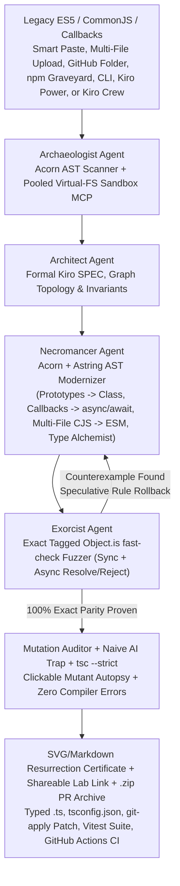

# Lazarus — Autonomous Legacy & Dead-Dependency Resurrection Engine

> **Kiroween Hackathon 2026 (Frankenstein Category)** | **Live Studio:** [lazarus-yf0a.onrender.com](https://lazarus-yf0a.onrender.com) | **Companion Kiro Crew App:** [lazarus-kiro-crew](https://github.com/anjarkar25-max/lazarus-kiro-crew) | **MIT License**
>
> **957 passing tests across 46 Vitest suites** (`1,002` combined with `lazarus-kiro-crew`) · **22 `.kiro/specs/` suites** · **Installable Kiro Power (`power-lazarus/`)** · **4 `.kiro/hooks/`** · **4-Agent Kiro Crew** · **Custom `lazarus-sandbox` MCP Server** · **`tsc --strict: 0 errors`**

Lazarus ingests unmaintained legacy ES5/CommonJS JavaScript—single files, **Node.js error-first `(err, res)` callbacks**, **multi-file `require()` dependency graphs** (via drag-and-drop upload or live **GitHub Folder URL**), zero-config custom pastes, packages from the **npm Graveyard**, or local directories via **CLI**—and autonomously resurrects them into strict ES2022/TypeScript backed by **exact `Object.is` differential fuzzing**, **clickable AST Mutant Autopsies**, **live Naive AI vs. Lazarus Trap comparisons**, and **real `tsc --strict` compiler verification**.

## System Architecture



## Quick Start

```bash
npm install
npm test                                                                   # 957 tests across 46 suites
npm start                                                                  # Launch Lazarus Studio on http://localhost:3000
npm run mcp                                                                # Start stdio MCP server (lazarus-sandbox)
npm run audit -- ./examples/legacy-invoice-engine                          # Scan a legacy repo for bitwise, callback, prototype & CJS risks
npm run benchmark                                                          # Run live parity & tsc --strict benchmark across all presets
npm run resurrect -- ./examples/legacy-quantize.cjs --out ./out            # Resurrect a single file via CLI
npm run resurrect -- ./examples/legacy-invoice-engine --out ./out-project  # Resurrect a multi-file CJS directory via CLI
```

## Install Across the Kiro Ecosystem

- **Kiro Power (`power-lazarus/`):** In **Kiro IDE** → **Powers** → **Add Custom Power** → import `power-lazarus/` (or GitHub URL `https://github.com/anjarkar25-max/lazarus/tree/main/power-lazarus`). Mentioning `legacy`, `commonjs`, `es5`, `resurrect`, or `mutation-audit` loads Lazarus's skills and `lazarus-sandbox` MCP server on demand.
- **Companion Kiro Crew App (`anjarkar25-max/lazarus-kiro-crew`):** Install via `kirocrew app install https://github.com/anjarkar25-max/lazarus-kiro-crew.git --ref main` for 3 autonomous Crew agents, 2 skills, a scheduled weekday legacy audit cron, `Cmd+K` commands, and an `@kirocrew/app-sdk` dashboard (45 passing tests).

## Real-World Legacy Parity Benchmark

| Specimen | Legacy Pattern | Subtle Edge Case Caught / Verified | Verified Outcome |
| :--- | :--- | :--- | :--- |
| `legacy-int-halve` | `var half = (n / 2) \| 0` | Naive refactor fails on `-0` (`Object.is(-0, +0)`) & negative odds (`-3`) | Self-healed + `tsc --strict: 0 errors` |
| `stringHash32` | ES5 hash loop with `\| 0` | 32-bit signed overflow (`-2147483648` vs `2147483648`) | Rule rolled back + Mutant Autopsy |
| `legacyReadConfigCb` | Node `(input, cb)` error-first callback | Both resolve values (`Object.is`) and error-path rejections | Lifted to `async/await` + `tsc --strict` |
| `legacyCounterClass` | `Counter.prototype.inc = function` | Prototype constructor, `this` binding, stateful methods | Lifted cleanly to ES2022 `class` |
| `cjsMathUtils` | Multi-export `exports.a / exports.b` | Multi-function CommonJS extraction + named ESM exports | 100% Exact Parity across all exports |
| `legacy-invoice-engine` | 3-file CommonJS `require('./...')` graph | Topological leaf-first stitching + whole-graph parity | Typed `.ts` project + `tsconfig.json` |
| `legacy-text-pipeline` | 3-file string pipeline (`trim`/`pad`/`slug`) | Relative CJS imports rewritten cleanly to ES2022 `import` | Typed `.ts` project + `tsc --strict` |
| `left-pad@1.3.0` (npm) | Live CDN fetch (`unpkg`/`jsdelivr`) | String coercion, padding boundaries, SHA-256 provenance | Verified + SVG/MD Certificate |

## Lazarus Studio V12 Highlights

- **Interactive Mutant & Counterexample Autopsy (`src/crew/mutation-audit.ts`, `public/index.html`):** Click the `Mutants Killed` badge in Tab 1 to inspect every injected AST fault, exact shrunken `fast-check` killer input, and exact `Object.is` output divergence.
- **Live "Naive AI vs. Lazarus" Trap Comparison (`src/crew/naive-refactor.ts`, `POST /api/compare-naive`):** Runs the Exorcist against a deterministic naive ES2022 rewrite right beside Lazarus's proven code, exposing `-0` and 32-bit overflow traps live with zero external API keys.
- **Error-First Callback `(err, res)` → `async/await` Necromancer (`src/crew/async-callback.ts`, `src/exporter/async-bundle.ts`):** Deterministically lifts legacy Node.js callback functions to typed `async`/`Promise<T>` functions and fuzzes both success and error paths in the isolated sandbox.
- **`lazarus audit <dir>` CLI Risk Scanner & Render Cold-Start Guard (`src/cli-audit.ts`, `GET /api/health`):** Scans repositories for bitwise traps, error-first callbacks, prototype chains, and CommonJS graph depth (`--json` or table output) while gracefully handling Render cold boots.
- **Installable Kiro Power (`power-lazarus/`), Live Kiro DNA Drawer & 4 v1 Hooks (`GET /api/kiro-dna`, `.kiro/hooks/`):** Reads all **22 `.kiro/specs/`**, 4 Crew personas, 4 hooks, steering docs, and `power-lazarus/` live from disk.
- **Multi-File Graph Intake, Smart Paste, Red-Team Sandbox & Verifiable PR Exports:** Drag-and-drop or GitHub Folder import, zero-config Smart Paste, isolated Tab 3 Red-Team sandbox proofing, live MCP wire-trace inspector, SVG/Markdown SHA-256 certificates, and `.zip` PR archives with GitHub Actions CI.

