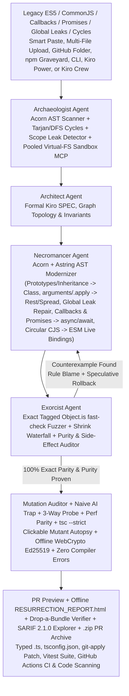

# Lazarus — Autonomous Legacy & Dead-Dependency Resurrection Engine

> **Kiroween Hackathon 2026 (Frankenstein Category)** | **Live Studio:** [lazarus-yf0a.onrender.com](https://lazarus-yf0a.onrender.com) | **Companion Kiro Crew App:** [lazarus-kiro-crew](https://github.com/anjarkar25-max/lazarus-kiro-crew) | **MIT License**
>
> **1,428 verified tests** (`1,564` combined with `lazarus-kiro-crew`'s 136 tests) · **Live Headless Browser E2E Suite (`0` errors)** · **30 `.kiro/specs/` suites** · **Installable Kiro Power (`power-lazarus/`)** · **4 `.kiro/hooks/`** · **4-Agent Kiro Crew** · **Custom `lazarus-sandbox` MCP Server** · **5-Pillar Proof + Offline WebCrypto Ed25519** · **SARIF 2.1.0 (`LAZ001`–`LAZ010`)** · **`tsc --strict: 0 errors`**

Lazarus ingests unmaintained legacy ES5/CommonJS JavaScript—single files, **undeclared global leaks & input mutators**, **ES5 prototype inheritance / `arguments` / `.apply()`**, **Node.js error-first `(err, res)` callbacks**, **Promise `.then().catch()` chains**, **multi-file & circular `require()` dependency graphs** (drag-and-drop upload or live **GitHub Folder URL**), zero-config pastes, packages from the **npm Graveyard**, or local directories via **CLI**—and autonomously resurrects them into strict ES2022/TypeScript backed by **5-pillar mathematical & cryptographic proof**:

1. **Exact `Object.is` Differential Fuzzing** (`fast-check` + live shrinking waterfall trace across sync & async resolve/reject paths)
2. **Purity & Side-Effect Parity** (undeclared global leak repair `global-leak-fix`, prototype-pollution checks, and deep input-mutation parity)
3. **Interactive Mutant Autopsy** (clickable AST fault diffs + shrunken killer inputs + Rule Blame X-Ray)
4. **Zero-Trust Offline WebCrypto Ed25519** (client-side `crypto.subtle` verification, live `Simulate 1-Byte Tamper`, and Drop-a-`.zip` Bundle Verifier)
5. **Runtime Performance Parity** (isolated sandbox micro-benchmark proving Legacy vs. Resurrected throughput parity)

## System Architecture



## Quick Start

```bash
npm install
npm test                                                                   # 1,428 verified unit & integration tests
npm run test:e2e                                                           # Live headless browser E2E suite (0 errors)
npm start                                                                  # Launch Lazarus Studio on http://localhost:3000
npm run mcp                                                                # Start stdio MCP server (lazarus-sandbox)
npm run audit -- ./examples/legacy-circular-ledger                         # Scan a legacy repo for bitwise, callback, prototype, leak & cycle risks
npm run audit -- ./examples/legacy-circular-ledger --sarif --out out.sarif # Export GitHub Code Scanning SARIF 2.1.0 report (LAZ001-LAZ010; add --security for LAZ010)
npm run verify -- ./out/resurrection-bundle.zip                            # Verify an Ed25519 signed Resurrection Certificate bundle
npm run benchmark                                                          # Run live parity & tsc --strict benchmark across all presets
npm run resurrect -- ./examples/legacy-quantize.cjs --out ./out            # Resurrect a single file via CLI
npm run resurrect -- ./examples/legacy-circular-ledger --out ./out-project # Resurrect a circular multi-file CJS graph via CLI
```

## Install Across the Kiro Ecosystem

- **Kiro Power (`power-lazarus/`):** In **Kiro IDE** → **Powers** → **Add Custom Power** → import `power-lazarus/` (or GitHub URL `https://github.com/anjarkar25-max/lazarus/tree/main/power-lazarus`). Mentioning `legacy`, `commonjs`, `es5`, `resurrect`, or `mutation-audit` loads Lazarus's skills (`--sarif` audits + resurrection) and `lazarus-sandbox` MCP server on demand.
- **Companion Kiro Crew App (`anjarkar25-max/lazarus-kiro-crew`):** Install via `kirocrew app install https://github.com/anjarkar25-max/lazarus-kiro-crew.git --ref main` for 3 autonomous Crew agents, 2 skills, a weekday legacy audit cron, `Cmd+K` commands, and an `@kirocrew/app-sdk` Mission Control dashboard with a 3-agent handoff timeline, **Crew Guardrail Policies**, a **hash-chained Signed Verification Audit Ledger**, live Naive AI trap, Purity + Perf Parity, Ed25519 1-byte tamper check, and inline SARIF 2.1.0 audit (**136 passing tests** + local `npm run preview` harness).

## Real-World Legacy Parity Benchmark

| Specimen | Legacy Pattern | Subtle Edge Case Caught / Verified | Verified Outcome |
| :--- | :--- | :--- | :--- |
| `legacy-int-halve` | `var half = (n / 2) \| 0` | Naive refactor fails on `-0` (`Object.is(-0, +0)`) & negative odds (`-3`) | Self-healed + Perf Parity + `tsc --strict` |
| `stringHash32` | ES5 hash loop with `\| 0` | 32-bit signed overflow (`338917376` vs Naive `7.22e+59`) | Shrink Trace + Rule Blame + Mutant Autopsy |
| `legacyLeakyMutator` | Undeclared global leak + input mutation | Naive strict-mode refactor throws `ReferenceError` | `global-leak-fix` + Purity Parity (`LAZ008`) |
| `legacyUnsafeMerge` | ES5 recursive merge over `for (k in src) { dst[k] = src[k]; }` | `JSON.parse('{"__proto__":{"polluted":true}}')` pollutes `Object.prototype` in the legacy code | `proto-pollution-guard` + live exploit probe (`({}).polluted === undefined`) + `LAZ009` |
| `legacySubclassMeter` | `Object.create` inheritance + `arguments`/`.apply()` | Prototype chain, `super()`, rest/spread lifting | ES2022 `class extends` + `tsc --strict` |
| `legacyReadConfigCb` | Node `(input, cb)` error-first callback | Both resolve values (`Object.is`) and error-path rejections | Lifted to `async/await` + `tsc --strict` |
| `legacyPromiseChain` | Legacy `.then().catch()` chain | Resolved values & error recovery parity | Lifted to `async/await` + `try/catch` |
| `legacyCounterClass` | `Counter.prototype.inc = function` | Prototype constructor, `this` binding, stateful methods | Lifted cleanly to ES2022 `class` |
| `legacy-circular-ledger` | 3-file circular `require()` cycle (`tax.cjs ↔ discount.cjs`) | Mutual CommonJS cycles lifted to cycle-safe ES2022 live bindings | Amber cycle graph + `tsc --strict` |
| `legacy-invoice-engine` | 3-file CommonJS `require('./...')` graph | Topological leaf-first stitching + whole-graph parity | Typed `.ts` project + SARIF CI |
| `left-pad@1.3.0` (npm) | Live CDN fetch (`unpkg`/`jsdelivr`) | String coercion, padding boundaries, Ed25519 + SHA-256 provenance | Verified + Signed Certificate |

## Lazarus Studio V19 Graveyard & Graph Studio Highlights
- **Famous npm Classics 1-Click Pack (`src/crew/graveyard-classics.ts`, `GET /api/graveyard-classics`):** Five iconic legacy utilities (`left-pad@1.3.0`, `is-number@3.0.0`, `ms@0.7.1`, `decamelize@1.2.0`, `pad-left@2.1.0`) ship as ES5 CommonJS snapshots with license, provenance and their legacy traps. One click on a chip in Tab 1's npm Graveyard imports the snapshot and runs the full resurrection and 5-pillar proof (`100% Exact Parity`, `tsc --strict: 0 errors`, Ed25519). `POST /api/import/npm` takes `source`: `live` (default), `snapshot` (no network) or `auto` (live CDN first, clean fallback to the snapshot on a timeout, rate limit or outage). Two snapshots inline a one-line dependency (`kind-of`, `repeat-string`); that is listed as a modification, never hidden.
- **Public API Contract Guard (`src/crew/api-contract.ts`):** Every graph resurrection compares the exported names, forms (named/default), kinds (function/class/value) and parameter counts of each original CommonJS module with the stitched ES module, both loaded in the sandbox, and returns an additive `apiContract` (`breakingChanges`, `totalExports`, `preservedExports`, per-module detail).
- **Interactive Tab 2 Graph Node Inspector:** Every graph node is a keyboard- and click-operable button with a highlight ring. Selecting one opens the Module Inspector below the graph: its cycle role (`Cycle Member`, `Entry`, `Leaf`), its preserved public exports, a per-file `tsc --strict` badge and an aligned Legacy CJS vs. Resurrected TypeScript diff. The results header shows `Public API Contract: 0 Breaking Changes (N/N Exports Preserved)` next to `Cycle Resolved (ESM Live Bindings)`.
## Lazarus Studio V19 Highlights
- **12-Case Adversarial Edge-Case Gauntlet (`src/crew/edge-gauntlet.ts`, `POST /api/edge-gauntlet`):** One click in the Tab 1 3-Way Judge Probe card runs up to 12 notorious inputs (`-0`, `NaN`, `±Infinity`, `2147483647`, `2147483648`, `-2147483648`, `-3`, `""`, `"\u0000"`, `"__proto__"`, a 64-char string) through Legacy, Naive AI and Lazarus in the sandbox, compared with exact tagged `Object.is`, and renders a red/green scorecard (`Lazarus: 12/12 Exact Parity · Naive AI: 5/12`) that highlights every trap. Cases are tailored to the schema (an `integer` takes only integral edges), so `total` is at most 12.
- **Prototype-Pollution & Loose-Equality Security Exorcist (`src/crew/security-exorcist.ts`):** The `proto-pollution-guard` Necromancer rule guards `for (k in src) { dst[k] = src[k]; }` loops with `Object.prototype.hasOwnProperty.call` and rejects `__proto__`, `constructor` and `prototype`; the Purity proof runs a live `JSON.parse('{"__proto__":{"polluted":true}}')` exploit probe on the resurrected code and shows **Proto-Pollution Blocked**. SARIF adds `LAZ009 PrototypePollutionRisk` (High) and `LAZ010 LooseEqualityCoercion` (Medium, opt-in with `lazarus audit --security` so every existing report stays identical).
- **Reproducible Proof Seeds & Seed Replay (`POST /api/resurrect`):** Every resurrection returns `proofSeed` and `numRuns`; the seed (sent by the client, or drawn by the server) goes straight into `fast-check`, is signed into the Ed25519 certificate, printed in `RESURRECTION_REPORT.html` and exported as `{ numRuns, seed }` in the Vitest suite. The Verification Deck shows a **Seed: N** chip and a **Re-Verify New Seed** button.
## Lazarus Studio V18 Highlights

- **5-Pillar Verification Deck & Purity Proof (`src/crew/purity-audit.ts`, `public/index.html`):** Scannable 5-Pill Proof Strip linking `Object.is` Parity, Purity/Zero Global Leaks (`LAZ008`), Mutant Autopsy, Offline WebCrypto Ed25519, and Performance Parity—repairing undeclared global leaks that crash strict ES2022/ESM.
- **Interactive GitHub PR Preview & Offline `RESURRECTION_REPORT.html` (`src/exporter/html-report.ts`):** Inspect the full Pull Request summary, file tree, unified `git diff`, and `git apply` one-liner right in Studio, and open a zero-dependency executive HTML report bundled inside every `.zip` export.
- **Hardcore ES5 & Async Lifters (`src/crew/es5-idioms.ts`, `src/crew/async-callback.ts`):** Deterministically modernises `Object.create` prototype inheritance, scope-safe constructors, `arguments`/`.apply()`, error-first `(err, res)` callbacks, and `.then().catch()` Promise chains across Web Studio, CLI, and MCP.
- **Live `fast-check` Shrink Trace & Clickable Rule Blame X-Ray (`public/index.html`):** Expand the counterexample shrinking waterfall inside the Causal Rollback Strip and click any AST rule chip to highlight exact modified or rolled-back diff lines.
- **Zero-Trust Offline WebCrypto Ed25519 & Drop-a-Bundle Verifier (`src/exporter/cert-crypto.ts`, `POST /api/verify-bundle`):** Verifies Ed25519 certificates directly in the browser via `crypto.subtle`, includes live `Simulate 1-Byte Tamper`, and validates dropped `.zip` PR archives.
- **Interactive SARIF 2.1.0 Risk Explorer & Circular CJS Cycle Resolver (`POST /api/audit-sarif`, `examples/legacy-circular-ledger/`):** Inspect clickable `LAZ001`–`LAZ008` findings and download `.sarif` directly from Studio, resolve mutual CommonJS `require()` cycles with amber SVG edges, and bundle drop-in GitHub Actions Code Scanning CI.
- **Kiro DNA Ecosystem Map, Installable Kiro Power & 4 v1 Hooks (`GET /api/kiro-dna`, `scripts/e2e-smoke.mjs`):** Visually maps all **30 `.kiro/specs/`**, 4 Crew personas, 4 hooks, 3 steering docs, `lazarus-sandbox` MCP, `power-lazarus/`, and `lazarus-kiro-crew` live from disk, verified by automated headless browser E2E checks.

